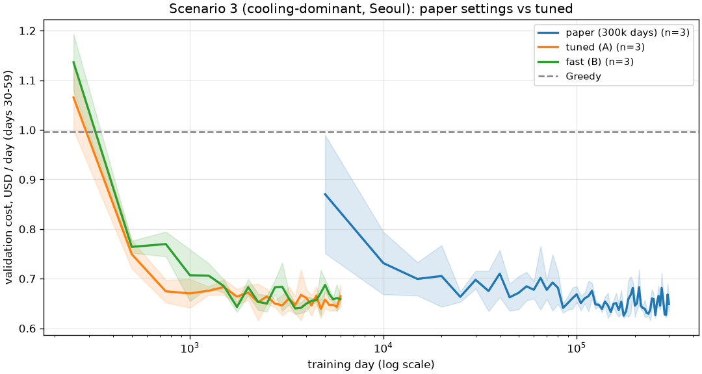
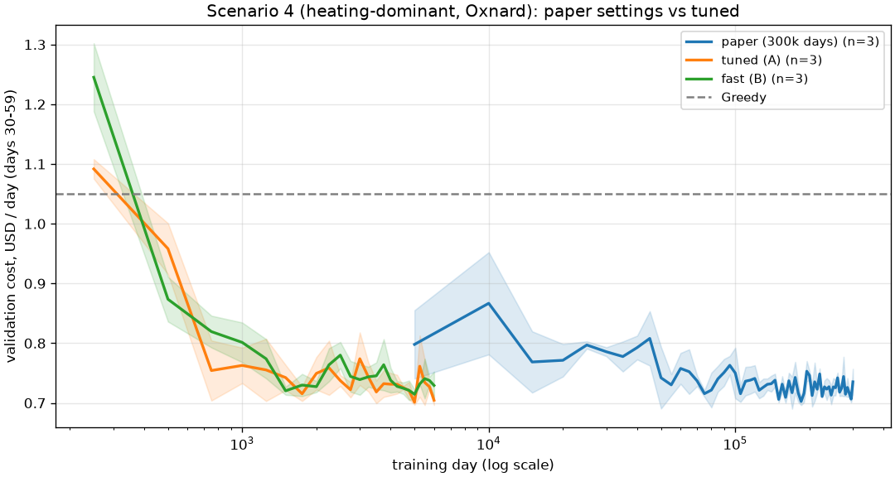
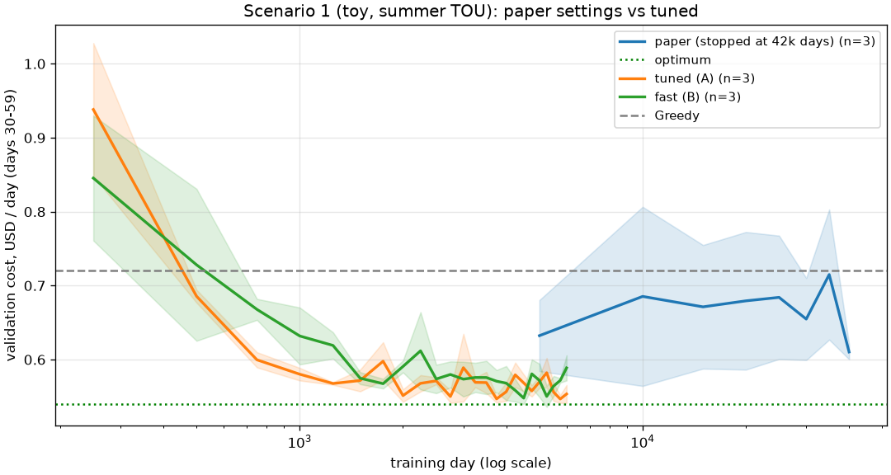
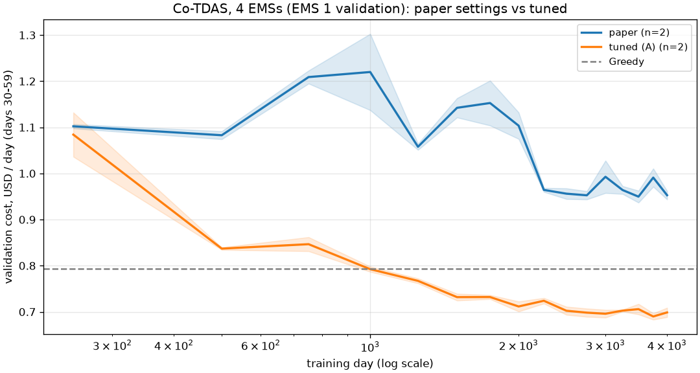
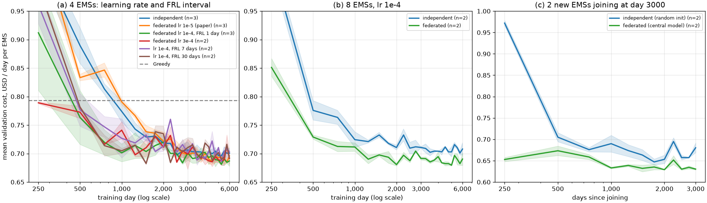
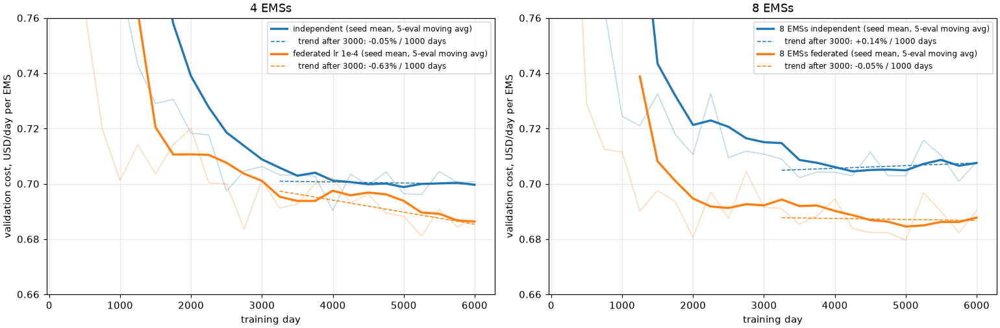
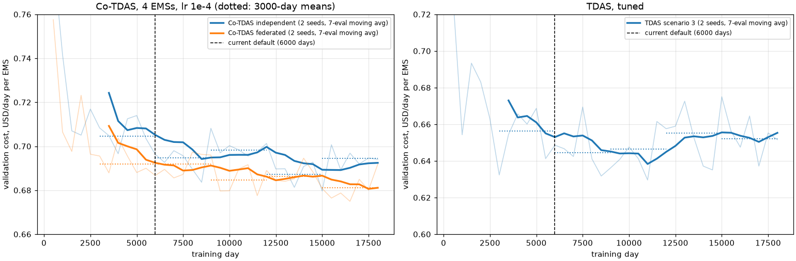
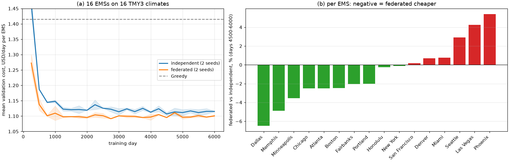
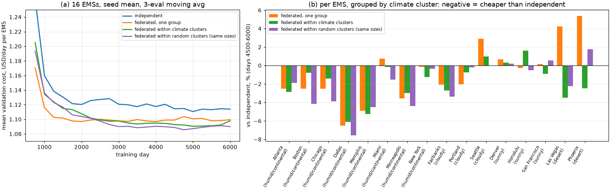
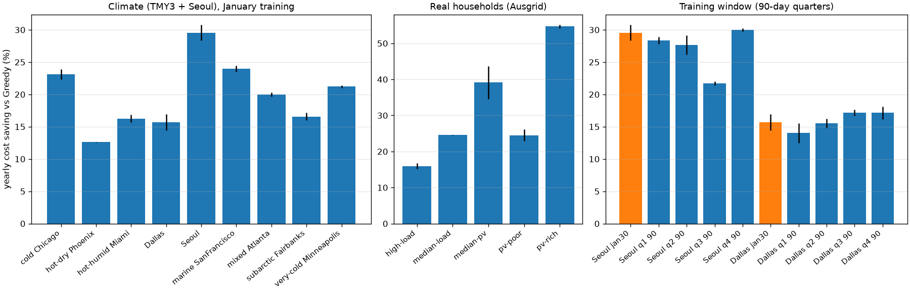

# 하이퍼파라미터 연구와 수렴 측정 (2026-11)

TDAS / Co-TDAS 학습 설정을 논문 원본 값에서 출발해 다시 정한 기록입니다.
모든 실행 계획은 [`experiments/plans/`](../experiments/plans/)에 있으며 `python -m experiments.suite --plan <file>`로 그대로 재현됩니다.

## 요약

- 논문 원래 설정(하루 1회 업데이트, target 20시간, 30만 일 학습)은 **수렴에 3.7만~6.8만 일**이 필요하고, 나머지 23만 일 이상은 개선이 없습니다.
- 수렴 속도는 경험한 일수가 아니라 **gradient 업데이트 횟수**가 결정합니다. 하루 24회 업데이트로 바꾸면 같은 성능에 **약 2~3천 일**(약 1/50의 데이터)에 도달합니다.
- 새 기본값(`tuned`)은 6000일, 약 10분 학습으로 논문 설정 30만 일(약 45분) 결과와 연간 비용 기준 0~3% 이내입니다.
- 토이 시나리오는 논문 설정으로 최적값에 도달하지 못했지만 `tuned`/`fast`는 최적값(0.540 $/일)에 도달합니다.
- Co-TDAS는 논문 설정(lr 1e-5, 하루 1회 업데이트)으로 4천 일을 돌리면 Greedy보다도 나쁩니다(0.96 vs 0.79). `tuned`는 0.70입니다.
- Co-TDAS 학습률은 1e-4가 가장 좋아 기본값으로 바꿨습니다. 연합은 독립 학습보다 최종 비용이 1~3% 낮고(기존 데이터 4→8 EMS에서 2→3%, 기후가 제각각인 16 EMS에서는 1.2%), 새로 합류한 EMS는 중앙 모델 덕분에 첫날부터 거의 수렴 수준(독립 학습 대비 약 1,000일 단축)입니다. 다만 Co-TDAS는 6000일 이후에도 아주 느리게 좋아져, 18,000일까지 학습하면 약 1.5% 더 낮아집니다. TDAS는 9,000일 이후 더 좋아지지 않습니다(`convergence-long-v1`).
- 기후가 제각각인 16 EMS는 2~4개 군집으로 나눠 군집 안에서만 연합하면 전체 연합보다 0.5~1% 낮고, 8개 군집이면 이득이 대부분 사라집니다. 평균적으로는 기후로 묶든 무작위로 묶든 차이가 잡음 수준이지만, 다른 집과 크게 다른 사막 2곳은 기후 군집에서만 일관되게 이득을 봅니다.

## 평가 방법

| 항목 | 정의 |
|---|---|
| 학습 데이터 | 각 시나리오의 첫 30일(1월)을 반복 |
| 검증 | 학습에 쓰지 않은 day 30–59, greedy 정책, 초기 배터리 1.5 kWh. 250일(탐색) 또는 5000일(기준선)마다 측정 |
| 모델 선택 | 검증 비용이 가장 낮았던 checkpoint (`best-validation-*.pt`) |
| 연간 비용 | 선택된 모델로 day 0–364 연속 rollout. 논문 Table IV와 비교용이며 선택에는 쓰지 않음 |
| 수렴 시점 | 3회 이동평균이 최종 수준(마지막 20% 평가의 중앙값)의 5% / 2% 이내에 처음 들어온 학습일 |
| 단위 | 비용 = 내부 단위 × 0.001 USD, 에너지 = 내부 단위 × 0.1 kWh |

DQN 검증값은 수렴 후에도 ±3~5% 진동합니다. 그래서 "범위 안에 계속 머무는 시점"은 판정 기준으로 쓰지 않습니다.

## 1. 논문 설정의 수렴 (plan: `convergence-paper-defaults-v1`)

| 시나리오 | 학습 | 최저 검증 | 최종 수준 | 5% 이내 | 2% 이내 | 연간 $/일 |
|---|---|---|---|---|---|---|
| 3 냉방 위주 (Seoul) | 30만 일 | 0.620 ± 0.001 | 0.646 ± 0.007 | 36,667 ± 10,274일 | 46,667 ± 11,785일 | 0.617 ± 0.002 |
| 4 난방 위주 (Oxnard) | 30만 일 | 0.694 ± 0.001 | 0.721 ± 0.006 | 60,000 ± 4,082일 | 68,333 ± 10,274일 | 0.617 ± 0.002 |
| 1 토이 (최적 0.540) | 4.2만 일에서 중단 | 0.577 ± 0.026 | 0.66 ± 0.05 | 진동, 최적 미도달 | — | — |

연간 합계는 시나리오 3이 225.7 $(논문 TDAS 220.6 $, MPC-24 214.5 $), 시나리오 4가 225.9 $(논문 TDAS 223.9 $, MPC-24 211.3 $)로, 논문 결과를 1~2% 이내로 재현합니다.
Greedy 기준선의 월별 비용도 Table IV와 거의 일치해 데이터와 단위가 논문과 같음을 확인했습니다.

## 2. 탐색 (시나리오 3, seed 2개)

`tuning-stage1-v1` (1만 일). 값은 후반 20% 검증 비용, ×0.001 $/일입니다.

| 설정 | 후반 검증 | 시간 |
|---|---|---|
| 논문 설정 | 746 ± 74 | 2분 |
| 비용 ÷100 | 742 ± 64 | 2분 |
| 업데이트 4회/일 + 비용 ÷100 | 684 ± 39 | 4분 |
| └ + lr 3e-4 / 시작 리플레이 1000 / target 240h / ε 1→0.05 / MSE | 669 ~ 689 | 3~4분 |
| 업데이트 24회/일 (비용 ÷100 또는 원래 비용) | 643 ~ 649 ± 14~21 | 19분 |

`tuning-stage2-v1` (6천 일, 24회/일 기준 변형):

| 설정 | 후반 검증 | 시간 |
|---|---|---|
| 48회/일 | 640 ± 8 | 19분 |
| 24회/일 + target 240h | 645 ± 8 | 10분 |
| 24회/일 + 폭 256 | 649 ± 26 | 2분 |
| 12회/일 | 652 ± 14 | 6분 |
| 24회/일 + lr 3e-5 / batch 128 | 652 ~ 653 | 5~8분 |
| 24회/일 + target 720h | 651 ± 25 | 9분 |
| 24회/일 + MSE (논문 식 19) | 665 ± 38 | 6분 |

비용 스케일만 바꾸면 효과가 거의 없었습니다(Adam + Huber). 그래도 Q값 크기를 1600에서 16 수준으로 낮춰 지표 해석이 쉬워지므로 유지했습니다.

## 3. 확인 (plan: `tuning-stage3-v1`)

- **A (`tuned`)**: 24회/일, target 240h, 비용 ÷100, 폭 512
- **B (`fast`)**: 12회/일, target 240h, 비용 ÷100, 폭 256
- 각각 6000일 학습, seed 3개 (Co-TDAS는 4천 일, seed 2개)

| | 논문 설정 | A (tuned) | B (fast) |
|---|---|---|---|
| 토이: 최저 검증 (최적 0.540) | 0.577 ± 0.026 | 0.542 ± 0.004 | **0.540 ± 0.000** |
| 시나리오 3: 최종 수준 / 연간 | 0.646 / **0.617** | 0.649 / 0.635 | 0.661 / 0.640 |
| 시나리오 4: 최종 수준 / 연간 | 0.721 / 0.617 | 0.721 / **0.615** | 0.729 / 0.637 |
| 2% 이내 도달 | 4.7만~6.8만 일 | 1.8천~2.8천 일 | 1.8천~2.1천 일 |
| 실행 1회 시간 (CPU 1스레드) | 약 45분 | 약 10분 | 약 2.7분 |
| Co-TDAS 4 EMS: 최종 수준 (Greedy 0.793) | 0.962 | **0.702** | — |






## 4. Co-TDAS: 연합학습의 효과와 튜닝 (plans: `co-tdas-value-v1`, `co-tdas-tuning-v1`)

4 EMS(기존 데이터 4곳, 요금 s/w × DC 20–35), `tuned` 설정으로 6000일, seed 3개입니다. 값은 EMS 평균 검증 비용이고, Greedy는 0.793 $/일입니다.

| | 500일 | 1000일 | 3000일 | 최종 수준 | 5% 이내 도달 | 연간 $/일 |
|---|---|---|---|---|---|---|
| 독립 학습 (CO=0) | 0.889 | 0.774 | 0.706 | 0.700 ± 0.003 | 1,833 ± 118일 | 0.609 |
| 연합 lr 1e-5 (논문 값) | 0.833 | 0.791 | 0.698 | 0.690 ± 0.005 | 2,500 ± 354일 | 0.594 |
| 연합 lr 1e-4 | **0.763** | **0.701** | 0.701 | **0.686 ± 0.005** | **1,083 ± 118일** | 0.598 |

- 연합은 최종 성능이 독립 학습보다 1.5~2% 좋습니다(연간 비용 기준 약 2%).
- 학습률 1e-5에서는 연합이 독립 학습보다 오히려 느립니다. EMS 변화량을 평균하면 라운드마다 실제 이동 폭이 줄어드는데, 낮은 학습률로는 이를 보충하지 못합니다.
- 학습률을 1e-4로 올리면 연합이 독립 학습의 최종 수준에 약 2배 빨리 도달합니다. 논문 Fig. 5의 가속 효과가 재현됩니다.

### 튜닝 (plan: `co-tdas-tuning-v1`, seed 2개)

같은 4 EMS 설정에서 학습률·연합 주기·업데이트 수를 바꾸고, 논문 Fig. 6–7에 해당하는 EMS 8개와 새 EMS 합류 실험을 했습니다. "최종 수준"은 마지막 20% 검증의 중앙값입니다.

| 설정 | 최종 수준 $/일 | 최저 | 5% 이내 도달 | 학습 시간 |
|---|---|---|---|---|
| **lr 1e-4, 연합 매일 (새 기본값)** | **0.686** | 0.678 | 1,000–1,250일 | 40분 |
| lr 3e-4 | 0.693 | 0.676 | 1,250일 | 40분 |
| lr 3e-4, 하루 12회 업데이트 | 0.698 | 0.678 | 1,000–1,250일 | 22분 |
| lr 1e-4, 연합 7일마다 | 0.703 | 0.683 | 1,000–1,750일 | 40분 |
| lr 1e-4, 연합 30일마다 | 0.694 | 0.682 | 1,000–1,250일 | 40분 |
| 독립 학습 (참고) | 0.700 | 0.688 | 1,750–2,000일 | 39분 |

| 실험 | 연합 | 독립 | 차이 |
|---|---|---|---|
| EMS 8개, 최종 수준 | **0.688** | 0.709 | 연합이 3.0% 낮음 |
| EMS 8개, 5% 이내 도달 | 1,000일 | 1,250–1,500일 | |
| 새 EMS 2개(3000일째 합류), 합류 직후 첫 검증 | **0.653** | 0.972 | |
| 새 EMS 2개, 최종 수준 | **0.630** | 0.660 | 연합이 4.5% 낮음 |
| 새 EMS 2개, 5% 이내 도달 | 합류 후 250일(첫 검증) | 1,000일 | |



- **학습률은 1e-4가 가장 좋습니다.** 3e-4는 초반이 가장 빠르지만(250일 0.79) 이후 진동이 커서 최종 수준이 1% 나쁩니다. `Co-TDAS.py` 기본값을 1e-4로 바꿨고, `--preset paper`는 계속 1e-5를 씁니다.
- **연합은 매일 하는 것이 좋습니다(논문과 같음).** 7일·30일 주기는 수렴 속도는 비슷하지만 최종 수준이 1~2.5% 나쁘고, 독립 학습과 거의 차이가 없어집니다. 통신량을 줄여야 할 때만 늘리세요.
- **하루 12회 업데이트는 시간이 절반**이고 최종 수준은 약 1% 나쁩니다. 빠른 탐색용으로 쓸 만합니다(`--updates-per-day 12`).
- **EMS가 많을수록 연합의 이득이 커집니다.** 4개일 때 2%, 8개일 때 3%입니다.
- **가장 큰 이득은 새 EMS 합류입니다(논문 Fig. 6 재현).** 중앙 모델로 시작한 EMS는 합류 직후부터 독립 학습의 최종 수준보다 좋고, 독립으로 시작한 EMS는 약 1,000일이 걸리고도 4.5% 나쁩니다.
- **6000일에 완전히 수렴하지는 않습니다.** 빠른 감소는 1,000~1,500일에 끝나지만, 그 뒤에도 느린 개선이 이어집니다. 위 표의 "5% 이내 도달"은 마지막 20% 구간을 기준으로 잡은 값이라, 그 구간 자체가 아직 움직이면 수렴을 과대평가합니다. 점 하나하나의 진동(약 ±1.3%)이 이 추세보다 커서 로그 축 그림에서는 잘 보이지 않습니다.



### 얼마나 길게 학습해야 하나 (plan: `convergence-long-v1`, 18,000일, seed 2개)

3000일 구간별 평균 검증 비용($/일)입니다.

| | 0–3k | 3–6k | 6–9k | 9–12k | 12–15k | 15–18k | 6k → 18k |
|---|---|---|---|---|---|---|---|
| Co-TDAS 연합 (4 EMS, lr 1e-4) | 0.713 | 0.692 | 0.692 | 0.685 | 0.686 | **0.681** | −1.6% |
| Co-TDAS 독립 | 0.728 | 0.705 | 0.695 | 0.698 | 0.687 | 0.695 | −1.4% |
| TDAS 시나리오 3 | 0.676 | 0.656 | **0.645** | 0.646 | 0.655 | 0.652 | 6–9k 이후 개선 없음 |



- **TDAS는 6000~9000일이면 충분합니다.** 6–9k 구간이 가장 낮고, 이후는 0.645~0.655 사이에서 오르내립니다. 오래 학습해도 좋아지지 않고 DQN 진동만 남습니다.
- **Co-TDAS는 18,000일까지 아주 느리게 좋아집니다.** 연합은 3000일당 약 0.4%씩, 6000일 대비 1.6% 더 낮아졌습니다. 9,000일 이후 기울기는 1000일당 −0.1% 이하로, 검증 진동보다 훨씬 작습니다.
- **연합의 이득은 커지지 않습니다.** 구간별 연합−독립 차이는 0.1~2.0%로 들쭉날쭉하고, 평균은 약 1.2%입니다. 4 EMS에서 연합의 장점은 최종 성능보다 **초반 속도**(약 2배)와 **새 EMS 합류**에 있습니다.
- 결론: 6000일은 TDAS에는 충분하고, Co-TDAS에서는 최종값보다 약 1~1.5% 높은 지점에서 멈춥니다. 마지막 1%가 필요하면 Co-TDAS를 12,000일(`--iterations 400`, 약 80분)로 학습하세요.

### EMS 16개, 서로 다른 기후 (plan: `co-tdas-16-v1`, 6000일, seed 2개)

TMY3 16곳(주마다 한 곳, 알래스카부터 하와이까지)에 EMS를 하나씩 두었습니다. 요금은 DC 20/25/30/35와 여름·겨울 TOU를 반복해 배정했습니다. 데이터가 달라 4·8 EMS(기존 데이터)와 비용 수준은 직접 비교할 수 없습니다.

| | 0–1.5k | 1.5–3k | 3–4.5k | 4.5–6k | Greedy 대비 절감 (4.5–6k) | 학습 시간 |
|---|---|---|---|---|---|---|
| 연합 | **1.136** | **1.097** | **1.099** | **1.100** | **22.2%** | 113분 |
| 독립 | 1.198 | 1.124 | 1.118 | 1.114 | 21.3% | 113분 |



- **연합이 전체 평균으로 1.2% 낫습니다.** 4개일 때 2%, 8개일 때 3%보다 작습니다. EMS 수가 늘어도, 기후가 서로 다르면 이득이 커지지 않습니다.
- **초반 이득은 큽니다.** 첫 1,500일 평균이 5.2% 낮습니다.
- **가구별로는 엇갈립니다.**
  - 연합이 유리한 곳: Dallas −6.5%, Memphis −4.9%, Minneapolis −3.6% 등 10곳.
  - 연합이 불리한 곳: Phoenix +5.4%, Las Vegas +4.3%, Seattle +2.9%.
  - 사막 지역은 PV가 많아 다른 집과 최적 행동이 다르고, 평균 모델이 이를 덜 반영하는 것으로 보입니다. 가구별 seed 차이(최대 3%)를 감안하면, ±2% 안쪽 차이는 구분할 수 없습니다.
- **수렴은 4·8 EMS보다 빠르고 평탄합니다.** 두 방식 모두 1,000일에 5% 이내에 들어오고, 3000일 이후 추세는 1000일당 ±0.5% 이내입니다.
- 시사점: 기후가 다양한 집단에서는 비슷한 집끼리 묶어 연합하는 방식(클러스터 연합)이나 개인화(공유 층 + 개별 출력층)가 다음 개선 방향입니다.

### 군집별 연합 (plan: `co-tdas-16-clusters-v1`, 16 EMS, 6000일, seed 2개)

`--clusters`로 EMS마다 군집 번호를 주면 같은 번호끼리만 집계합니다. 군집마다 중앙 모델이 따로 있고, 새 EMS는 자기 군집의 모델로 합류합니다. 군집이 하나면 기존 연합과 가중치까지 같습니다.

- **기후 군집**: 연간 PV 발전량, 7월/1월 부하 비, 1~2월 PV/부하 비로 k-means(k=4)를 돌린 결과입니다.
  - 습윤·대륙성 8곳: Miami, Atlanta, Chicago, Boston, Minneapolis, New York, Memphis, Dallas
  - 흐린 북서부·알래스카 3곳: Fairbanks, Portland, Seattle
  - 일조 많고 온화 3곳: San Francisco, Denver, Honolulu
  - 사막 2곳: Phoenix, Las Vegas
- **무작위 군집(대조군)**: 크기는 같고(8/3/3/2), 같은 기후 군집의 집들이 서로 다른 군집으로 흩어지게 뽑았습니다.

| | 0–1.5k | 1.5–3k | 3–4.5k | 4.5–6k | Greedy 대비 절감 | 독립 대비 2% 넘게 나쁜 EMS |
|---|---|---|---|---|---|---|
| 독립 | 1.198 | 1.123 | 1.118 | 1.114 | 21.3% | |
| 전체 연합 | **1.136** | 1.098 | 1.098 | 1.100 | 22.2% | 3곳 (최대 +5.4%) |
| 기후 군집 연합 | 1.160 | 1.100 | 1.094 | 1.094 | 22.7% | 0곳 (최대 +1.6%) |
| 무작위 군집 연합 | 1.155 | **1.096** | **1.089** | **1.090** | **23.0%** | 0곳 (최대 +1.8%) |



- **군집으로 나누면 전체 연합보다 낫습니다.** 최종 비용이 0.5~0.9% 낮고, 연합 때문에 손해 보는 집이 사라집니다.
- **그런데 기후로 묶은 효과는 확인되지 않습니다.** 무작위 군집도 기후 군집만큼, 평균으로는 오히려 조금 더 좋습니다. 둘의 차이(0.4%)는 seed 사이 차이(최대 0.9%)보다 작습니다.
  - 이득의 주된 원인은 "비슷한 집끼리"가 아니라 **한 번에 평균하는 집 수가 줄어든 것**으로 보입니다. 16곳의 변화량을 한꺼번에 평균하면 집마다 다른 방향의 학습이 서로 상쇄됩니다. 군집이 작으면 각 집의 개별 적응이 더 많이 남습니다.
- **기후 군집이 분명히 도움이 되는 곳은 사막 지역입니다.** Phoenix는 전체 연합 +5.4%, 무작위 군집 +1.8%, 기후 군집 −2.5%입니다. Las Vegas는 각각 +4.3%, −2.2%, −3.5%입니다. 다른 집과 크게 다른 소수 가구에는 비슷한 집끼리 묶는 것이 의미가 있습니다.
- **초반 속도는 전체 연합이 가장 빠릅니다.** 첫 1,500일은 전체 연합 1.136, 군집 연합 1.155~1.160입니다.

#### 군집 수 (plan: `co-tdas-16-cluster-count-v1`, seed 2개)

같은 k-means 특성으로 k=2, 8 기후 군집을 만들고, 같은 크기의 무작위 군집을 대조군으로 두었습니다. k=4 기후 군집을 다시 뽑아도 위와 같은 묶음이 나와 기존 결과를 그대로 씁니다.

- 기후 k=2: 사막 2곳(Phoenix, Las Vegas) / 나머지 14곳
- 기후 k=8: 크기 1~4. Fairbanks, Denver, Miami는 혼자라 사실상 독립 학습입니다.
- 무작위 k=2는 8곳씩, k=8은 2곳씩입니다.

| 군집 수 | 군집 | 0–1.5k | 4.5–6k | seed별 4.5–6k | Greedy 대비 절감 | 독립 대비 2% 넘게 나쁜 EMS |
|---|---|---|---|---|---|---|
| 1 (전체 연합) | | **1.136** | 1.100 | 1.099 / 1.102 | 22.2% | 3곳 |
| 2 | 기후 | 1.146 | 1.094 | 1.100 / 1.088 | 22.7% | 2곳 |
| 2 | 무작위 | 1.143 | 1.101 | 1.100 / 1.101 | 22.2% | 2곳 |
| 4 | 기후 | 1.160 | 1.094 | 1.096 / 1.093 | 22.7% | 0곳 |
| 4 | 무작위 | 1.155 | **1.090** | 1.090 / 1.089 | **23.0%** | 1곳 |
| 8 | 기후 | 1.165 | 1.103 | 1.104 / 1.102 | 22.0% | 3곳 |
| 8 | 무작위 | 1.183 | 1.104 | 1.101 / 1.106 | 22.0% | 2곳 |
| 16 (독립) | | 1.198 | 1.114 | 1.109 / 1.119 | 21.3% | |

- **군집 수는 2~4가 가장 좋고, 8이면 이득의 대부분이 사라집니다.** "작을수록 좋다"가 아니라 중간에 최적이 있습니다. 군집당 2곳이면 평균할 경험이 너무 적어 독립 학습에 가까워집니다. 위에서 세운 "평균하는 집 수가 줄어서 좋아진다"는 가설은 k=4까지만 맞습니다.
- **초반 속도는 군집이 클수록 빠릅니다.** 첫 1,500일 비용이 군집 수 1 → 2 → 4 → 8 → 16 순서로 1.136 → 1.14 → 1.16 → 1.17~1.18 → 1.198입니다. 공유하는 경험이 많을수록 빨리 배웁니다.
- **같은 군집 수에서 기후 대 무작위의 평균 차이는 잡음 수준입니다.** k=2는 기후가, k=4·8은 무작위가 조금 낫고, 모두 seed 사이 차이(최대 1.1%) 안입니다.
- **사막 2곳에는 기후 군집이 일관되게 낫습니다.** 독립 대비 Phoenix는 기후 −2.7 / −3.6 / −4.1%, 무작위 +0.5 / +1.0 / +5.1%(k=2/4/8)입니다. Las Vegas는 기후 −2.5 / −4.3 / −5.6%, 무작위 +0.6 / −3.4 / −0.4%입니다. 이 결과는 세 k 모두에서 같은 방향입니다.
- **실용적 결론:** 다른 집과 크게 다른 소수(여기서는 사막 2곳)만 떼어 내는 기후 k=2가 가장 단순하면서 성능은 최상위권입니다. Seattle(+3.2%)은 여전히 손해라, 남은 과제는 소수 가구 개인화입니다(예: 공유 층과 집마다 따로 둔 출력층).

### 탐색률 ε (plan: `epsilon-v1`, 6000일, seed 2개)

기준은 논문 값 0.1 고정입니다(`co-fed-lr1e4` seed 3개, `s3-A-sc3` seed 3개). 값은 구간 평균 검증 비용($/일), "진동"은 3000일 이후 추세선 주변 표준편차입니다.

| | 1.5–3k | 3–4.5k | 4.5–6k (seed별) | 진동 |
|---|---|---|---|---|
| Co-TDAS ε 0.1 고정 (기준) | 0.703 | 0.696 | 0.687 (0.690, 0.684, 0.686) | 0.009 |
| Co-TDAS ε 0.1→0.01 (3000일 선형) | 0.699 | 0.691 | 0.688 (0.688, 0.687) | 0.010 |
| Co-TDAS ε 0.05 고정 | 0.701 | 0.692 | 0.690 (0.690, 0.690) | 0.011 |
| Co-TDAS ε 0.01 고정 | 0.698 | 0.696 | 0.681 (0.677, 0.684) | 0.013 |
| TDAS ε 0.1 고정 (기준) | 0.658 | 0.658 | 0.650 (0.656, 0.643, 0.651) | 0.022 |
| TDAS ε 0.1→0.01 | 0.653 | 0.660 | 0.649 (0.653, 0.645) | 0.024 |
| TDAS ε 0.05 고정 | 0.652 | 0.646 | 0.642 (0.632, 0.653) | 0.013 |
| TDAS ε 0.01 고정 | 0.648 | 0.646 | 0.663 (0.667, 0.658) | 0.025 |

- **ε를 바꿔도 결과가 일관되게 좋아지지 않습니다.** 차이는 대부분 ±1% 안이고, seed 사이 차이(최대 2%)보다 작습니다.
- **같은 0.01 고정도 알고리즘에 따라 방향이 반대입니다.** Co-TDAS에서는 가장 낮고(0.681), TDAS에서는 가장 높습니다(0.663). 일관된 효과라기보다 seed 운으로 보입니다.
- **6000일 이후의 진동은 ε 때문이 아닙니다.** 검증은 무작위 행동 없이 하므로 ε는 학습 데이터에만 영향을 주는데, ε를 줄여도 진동이 줄지 않고 0.01에서는 오히려 커집니다. 진동의 원인은 DQN 업데이트 자체(target 동기화, 리플레이 분포 변화)로 보입니다.
- 결론: **논문 값 0.1 고정을 유지합니다.**

## 5. 새 가구·시나리오 (plan: `scenarios-v1`)

TDAS `tuned`, 6000일, seed 2개입니다. 데이터는 [datasets.md](datasets.md)를 참고하세요. "연간 절감"은 검증 기준 최적 모델로 1년을 rollout했을 때 Greedy 대비 비용 감소율이고, 학습 창을 포함합니다.

| 그룹 | 연간 절감 | 최종 수준 5% 이내 도달 |
|---|---|---|
| Seoul (새 PV) | 29.6% | 1,750일 |
| 냉방이 작은 기후: San Francisco 24.0, Chicago 23.1, Minneapolis 21.2, Atlanta 20.0 | 20–24% | 1,100–1,400일 |
| 냉방 위주와 극한 기후: Phoenix 12.6, Dallas 15.7, Miami 16.3, Fairbanks 16.6 | 13–17% | 1,000–1,500일 |
| Ausgrid 실측: PV 많음 54.7, 중간 PV 39.1, 중간 부하 24.5, PV 적음 24.5, 고부하 16.0 | 16–55% | 1,000–2,600일 |
| 학습 창 90일 (1~4분기) | 1월 30일 학습 대비 Seoul −7.9 ~ +0.4%p, Dallas −1.7 ~ +1.5%p | 750–2,400일 |



- **6000일은 모든 새 가구에 충분합니다.** 가장 늦은 경우도 약 2,600일이었습니다(PV 많은 Ausgrid 가구, 비용이 거의 0이라 상대 변동이 큼).
- **1월로만 학습한 정책은 여름 냉방 부하가 큰 지역에서 이득이 작습니다**(Phoenix 12.6%). 논문 Remark 2와 같은 경향입니다.
- **그런데 학습 창을 여름으로 옮겨도 효과가 작습니다.** Dallas는 3분기(여름)로 학습해도 +1.5%p에 그칩니다. Seoul은 3분기로 학습하면 오히려 7.9%p 나빠집니다. 한 계절만 보고 학습하면 나머지 계절로 일반화가 안 된다는 뜻이므로, 다음 단계로는 여러 계절을 섞어 학습하는 방식이 유망합니다.
- PV 비중이 클수록 절감 여지가 큽니다. 남는 발전량을 저장해 비싼 시간대와 피크를 피할 수 있기 때문입니다.

## 적용된 기본값

`TDAS.py`, `Co-TDAS.py`의 기본값과 `experiments.run_original --preset`:

| 항목 | paper | **tuned (기본)** | fast |
|---|---|---|---|
| `iteration` (30일 반복 수) | 5000 (토이) / 10000 | 200 (6000일) | 200 |
| `updates_per_day` | 1 | 24 | 12 |
| `freq` (target 동기화, 시간) | 20 | 240 | 240 |
| `cost_scale` | 1 | 100 | 100 |
| 은닉층 폭 | 512 | 512 | 256 |
| lr | TDAS 1e-4, Co-TDAS 1e-5 | TDAS 1e-4, **Co-TDAS 1e-4** | 같음 |
| 연합 주기 `frl_days` | 1 | 1 | 1 |
| γ, batch, 리플레이, ε | 논문 값 그대로 (0.98, 32, 20000/5000, 토이 0.01·그 외 0.1) | 같음 | 같음 |

`--preset paper`는 수정 전 코드와 학습 결과·모델이 비트 단위로 같습니다(같은 seed). `--source upstream`일 때는 자동으로 `paper`를 씁니다.

## 논문 대조

구현이 논문과 일치하는 부분:
- 상태 정의: DC-free amount, 시간 one-hot, 24시간 TOU, Tf=2 예보 (식 16–17)
- Algorithm 1: 하루 끝에 학습, `T_target` 주기 동기화
- 식 22–23: 경험 수 가중 연합 집계, 집계 후 local·target 모두 central로 교체
- Table II 요금표, p_D = 0.3 $/kWh, B_max 4 kWh, B_rate 2 kWh, B0 1.5 kWh, 데이터 매핑(Seoul/Oxnard, 1월 학습)

이번에 바로잡은 불일치:
- 여름 요금 구간: 코드가 9/28–30을 겨울로 처리하던 것을 4/1–9/30으로 수정
- 테스트 기간 360일 → 365일
- 하네스가 ε를 항상 0.1로 덮어써, 토이 시나리오의 논문 값 0.01이 무시되던 문제

남은 차이(의도적으로 유지):
- loss: 논문은 MSE(식 19), 코드는 Huber. 탐색에서 MSE가 더 불안정해 Huber를 유지
- 행동 집합: 논문 식 8은 수요 충족만 요구하고 초과 구매는 버려지지만, 코드는 배터리 용량·충전율을 넘는 구매를 아예 금지합니다. 버려지는 구매는 항상 손해라서 최적해는 같습니다.
- "epoch" 정의: 본문은 1 epoch = 하루(10000 epochs)라고 쓰지만, 코드와 새 EMS 합류 시점(5000 epochs)은 30일 반복을 1 epoch로 봅니다. 측정 결과로는 어느 쪽이든 필요량을 넘습니다.

## 한계

- seed 2~3개, 검증 구간 30일이라 ±1~2% 차이는 구분하지 못합니다.
- 연간 비용은 학습 구간(1월)을 포함합니다(논문과 동일). 순수 hold-out 성능은 `python -m experiments.evaluate <run>`(day 61–365)을 쓰세요.
- 수렴 후 진동이 있어 마지막 모델이 아니라 검증 기준 최적 checkpoint를 써야 합니다.

## 재현

```bash
# 새 기본값으로 한 번 학습 (시나리오 3, 약 10분)
.venv/bin/python -m experiments.run_original --scenario 3 --seed 0 --eval-every 250
# 논문 설정 그대로
.venv/bin/python -m experiments.run_original --preset paper --scenario 3 --seed 0 --eval-every 5000
# 이 문서의 확인 실험 전체
.venv/bin/python -m experiments.suite --plan experiments/plans/tuning-stage3-v1.json --workers 6
# Co-TDAS 연합 효과와 튜닝
.venv/bin/python -m experiments.suite --plan experiments/plans/co-tdas-value-v1.json --workers 6
.venv/bin/python -m experiments.suite --plan experiments/plans/co-tdas-tuning-v1.json --workers 6
# EMS 16개 (TMY3 16곳, 약 2시간)
.venv/bin/python -m experiments.suite --plan experiments/plans/co-tdas-16-v1.json --workers 4
# 16 EMS 군집별 연합 (약 2시간)
.venv/bin/python -m experiments.suite --plan experiments/plans/co-tdas-16-clusters-v1.json --workers 4
# 16 EMS 군집 수 비교 (k=2, 8, 약 2시간 15분)
.venv/bin/python -m experiments.suite --plan experiments/plans/co-tdas-16-cluster-count-v1.json --workers 8
# 탐색률 ε 비교
.venv/bin/python -m experiments.suite --plan experiments/plans/epsilon-v1.json --workers 6
# 18,000일 수렴 확인 (약 2시간)
.venv/bin/python -m experiments.suite --plan experiments/plans/convergence-long-v1.json --workers 6
# 그룹 리포트와 비교 그림
.venv/bin/python -m experiments.report --group tuned-s3 results/runs/s3-A-sc3-seed*
.venv/bin/python -m experiments.report --compare --out compare.png "paper=results/runs/base-s3-*" "tuned=results/runs/s3-A-sc3-*"
```
